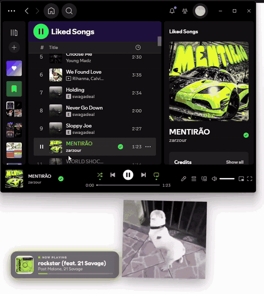

# Overlay Studio

Windows desktop library for building, running, and customizing local OBS overlays.

<p align="center">
  
</p>

## Quickstart

1. Open `Overlay Studio.bat`.
2. Click **Start server**.
3. Open an overlay card, copy its URL, and add it as an OBS Browser Source.

The app shows whether the local server is running and gives each overlay its own
customization page and OBS URL. Saved changes refresh connected overlays automatically.
Library cards mirror live overlay state, including the current Spotify track, artwork,
artist, and playback progress.

If the Python environment is ever removed, run `larpdog-server\install.bat` once before
opening the control app again.

`Overlay Studio.bat` uses `Overlay Studio.exe` when a packaged build is present and
otherwise opens the Python desktop app directly.

## Overlay library

- **Larpdog Dance** is an audio-reactive dance GIF. Choose any custom GIF from its
  settings page; Overlay Studio copies it into `user-assets/` and keeps the existing
  beat reaction and playback behavior.
- **Spotify Overlay** shows Windows now-playing metadata and album artwork from Spotify.
- **Match Record** is a transparent win/loss banner with controls for wins, losses,
  title, and accent color.

The browser source URLs are:

```text
http://127.0.0.1:8473/overlays/larpdog-dance
http://127.0.0.1:8473/overlays/spotify
http://127.0.0.1:8473/overlays/win-loss
```

Chat integrations can update it through `POST /api/win-loss` using the actions `win`,
`loss`, `undo-win`, `undo-loss`, and `reset`.

## Project layout

- `overlay_studio.pyw` is the desktop application.
- `overlay-studio.html` renders the Dance and Spotify browser sources.
- `assets/dancing-dog.gif` is shown while music is playing.
- `assets/resting-dog.png` is shown when no track is playing.
- `user-assets/` stores custom Dance media.
- `larpdog-server/` is the local compatibility service that captures system audio and
  sends Windows now-playing data over a local websocket.

More setup detail lives in `larpdog-server/README.md`.
